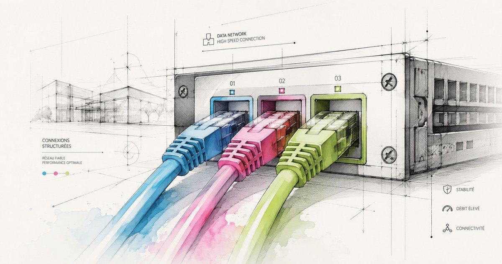

# DNDVDL-MAP, page de présentation

**La baie informatique, lisible par ceux qui y ont droit. Les données, gardées par vous.**

Un câble débranché, et personne ne sait où il menait. Le plan de la baie dort dans un tableur que seul son auteur comprend. DNDVDL-MAP dessine chaque port, chaque câble et chaque bureau, pour que la baie se lise d'un coup d'œil, par ceux qui y ont droit.

Ce dépôt contient la page de présentation de DNDVDL-MAP, outil privé de gestion et d'organisation des baies informatiques. L'outil lui-même n'est pas ouvert au public : l'accès se fait sur demande, après validation.

  
  

## Le principe : le contenant est en ligne, le contenu jamais

| Où | Rôle | Ce qui s'y trouve |
|:--|:--|:--|
| En ligne, GitHub Pages | Le contenant | Le code de l'application, public et identique pour tous. Aucune donnée d'infrastructure |
| En ligne, Supabase | Les comptes | E-mail, mot de passe, statut et rôle. Aucune baie, aucun port |
| Sur l'appareil | Le contenu | Le fichier de la baie (ports, câbles, prises murales, bureaux, équipements, adresses), importé et exporté à la main. Jamais envoyé en ligne |

## Ce que présente la page

| Rubrique | Contenu |
|:--|:--|
| Lire | La baie telle qu'elle est câblée : bandeaux de brassage, switchs, tiroirs, NAS, onduleur. Les câbles prennent la couleur de leur usage |
| Suivre | Un clic sur un port trace le câble jusqu'au switch et ouvre sa fiche : bureau, prise murale, ports, adresse IP |
| Valider | Chacun peut demander un accès, mais rien ne s'ouvre avant la décision de l'administrateur |
| Consulter | En lecture seule, la baie se parcourt sans outils de modification, sous un filigrane nominatif |
| Protéger | Nom, date et heure en filigrane sur tout l'écran, mis à jour toutes les 30 secondes : toute capture reste signée |

## Principes

- Aucune donnée d'infrastructure stockée en ligne.
- 3 rôles : administrateur, éditeur, lecteur. Le statut de chaque compte est vérifié par la base, pas par l'écran.
- QR codes des baies générés sur l'appareil, sans appel à un service extérieur.
- Aucun cookie, aucun traceur, aucune publicité sur la page de présentation.
- Toutes les captures utilisent des données fictives.
- Page non référencée par les moteurs de recherche.

## Technique

Page statique en HTML, CSS et JavaScript, sans dépendance, hébergée sur GitHub Pages. Polices Space Grotesk, Instrument Serif et IBM Plex Mono sous licence SIL Open Font License 1.1 (voir `fonts/OFL.txt`).

---

DNDVDL-MAP, projet d'Anthropotech Lab. Conçu et développé par Shams &amp; Dean. 
© 2026 Shams Guettaf, Anthropotech Lab. Tous droits réservés. Voir <a href="LICENSE">LICENSE</a> et les <a href="https://shamsetdean.github.io/dndvdl-presentation/mentions-legales.html">mentions légales</a>.
